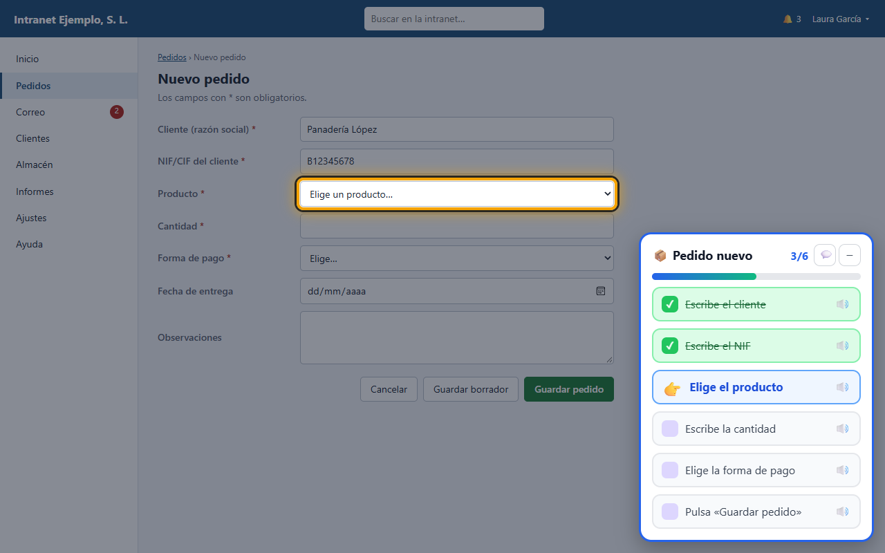
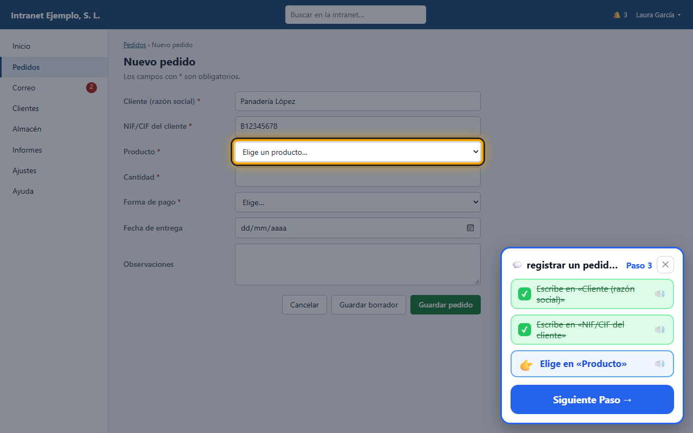
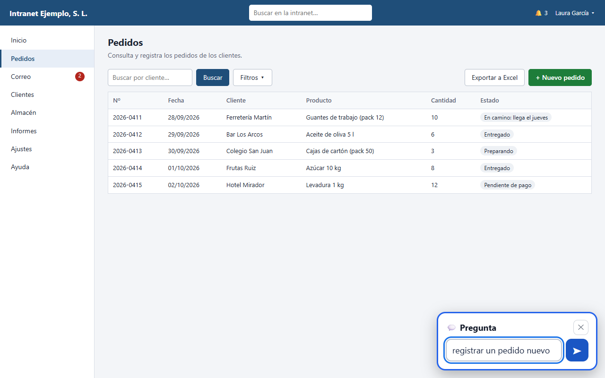
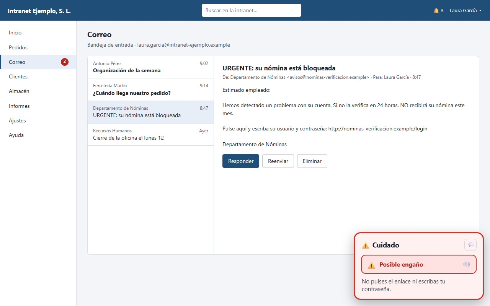

<div align="center">

# GuIA

**Un asistente que te guía paso a paso en cualquier página web, marcando en la pantalla dónde pulsar.**


</div>

---

> *Un paso cada vez, en la propia pantalla, sin tener que pedir ayuda a nadie.*

GuIA es una extensión de navegador pensada para personas con discapacidad intelectual o neurodivergencia que trabajan con aplicaciones web. No hay que abrir nada: una tarjeta pequeña en una esquina dice **qué hacer ahora** con pocas palabras, y el elemento que hay que usar se marca en la página mientras el resto se oscurece. Si la tarea no está prevista, se le pregunta a la IA y te va guiando **un paso cada vez**.

<div align="center">
  
  
  
  
</div>

## Cómo funciona

- **Sola, sin abrir nada.** En la intranet de demo detecta la tarea por la página (un pedido, una búsqueda, un correo) y muestra los pasos. Si te saltas uno o la página da un error, vuelve sola al paso que falta.
- **Preguntando a la IA, en cualquier web.** Pulsas 💬, escribes qué quieres hacer («enviar un correo a mi jefe») y Gemini te da el siguiente paso. Solo avanzas cuando pulsas **Siguiente Paso →**.
- **Segura por diseño.** Los pasos que envían, guardan o borran salen en rojo. Nunca te guía para escribir contraseñas ni datos bancarios, y avisa si un correo parece un engaño.
- **Privada.** A la IA solo le llegan los nombres de los botones y campos de la página. Nunca lo que hay escrito en ellos ni las contraseñas, y los correos y números largos se tapan.

## Qué hay en este repo

| | |
|---|---|
| 🧩&nbsp;**[`extension/`](extension)** | La extensión (Manifest V3, JavaScript sin compilar). [`content.js`](extension/content.js) pinta la tarjeta y la marca, [`snapshot.js`](extension/snapshot.js) lee la página, [`gemini.js`](extension/gemini.js) habla con la IA y [`tasks.js`](extension/tasks.js) tiene las tareas de la demo. |
| 🏢&nbsp;**[`demo-site/`](demo-site)** | «Intranet Ejemplo, S. L.»: una intranet inventada con pedidos y correo para probar sin datos reales. Incluye un correo fraudulento. |
| 📄&nbsp;**[`PLANNING.md`](PLANNING.md)** | El plan del proyecto: usuarios, principios de diseño, arquitectura, privacidad y marco legal (RGPD, Reglamento de IA) y fases. |
| 🗃️&nbsp;**[`archivo/`](archivo)** | La primera versión, con panel lateral. La descartamos por ser demasiado compleja para quien la iba a usar. |

## Probarlo

**Requisitos:** Chrome o Edge, [Node.js](https://nodejs.org) para la intranet de demo y una clave gratuita de la [API de Gemini](https://aistudio.google.com/apikey) para el modo IA.

**1. Descarga el repo y pon tu clave.** Copia `extension/config.example.js` como `extension/config.local.js` y pega tu clave en `apiKey`. Ese archivo está en `.gitignore`, así que nunca se sube.

```bash
git clone https://github.com/javirmmn/GuIA.git
```

```bash
copy GuIA\extension\config.example.js GuIA\extension\config.local.js
```

**2. Carga la extensión.** Abre `chrome://extensions` (o `edge://extensions`), activa el **Modo de desarrollador**, pulsa **Cargar descomprimida** y elige la carpeta `extension`.

**3. Arranca la intranet de demo** desde la carpeta del repo y abre http://127.0.0.1:8080:

```bash
node demo-site/server.js
```

Entra en **Pedidos → Nuevo pedido** para ver la guía automática, o pulsa 💬 en cualquier página y escribe, por ejemplo, «registrar un pedido nuevo».

## Lo que es (y lo que no)

GuIA es un **prototipo para enseñar la idea**, no un producto terminado:

- ✅ La guía automática funciona de principio a fin en la intranet de demo, sin IA.
- ✅ El modo IA guía tareas completas en la intranet de demo y en una página que imita a Gmail.
- ✅ Diseño pensado para la accesibilidad cognitiva: frases cortas, un paso cada vez, botones grandes y lectura en voz alta.
- ⚠️ **La clave de Gemini se guarda dentro de la extensión.** Vale para probar en tu ordenador; para repartirla haría falta un servidor que la guarde.
- ⚠️ **El nivel gratuito de Gemini** permite unas pocas peticiones por minuto y Google puede usar los datos para mejorar sus productos. Usa solo datos inventados.
- ⚠️ En tareas largas la IA puede perder el hilo: cada paso se pide por separado, con el modelo más pequeño de Gemini.
- ⚠️ No funciona en las páginas internas de Chrome, en PDF ni en webs que lo dibujan todo en un `canvas`, como Google Docs.

<div align="center">
<sub>Hecho en Málaga por<br>
Javier Román Meléndez · Mario Cáceres Morales · Noa Ramos Ruiz · Noelia Sánchez Vilchez · Javier Romeo Enríquez de Salamanca</sub>
</div>
